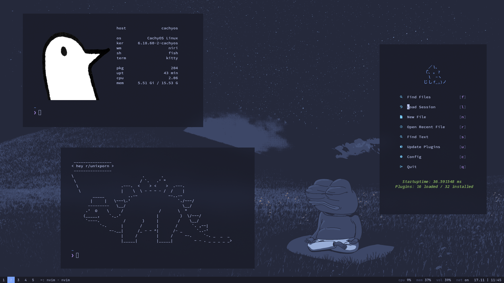

# dotfiles

my minimal and very blue [niri](https://github.com/YaLTeR/niri) rice for CachyOS.



## details

| Part | Program |
|---|---|
| WM | niri |
| Bar | Waybar |
| Launcher | fuzzel |
| Notifications | mako |
| Terminal | Kitty |
| Shell | fish |
| SysFetch | fastfetch |
| Music | rmpc + mpd |
| Wallpaper | swaybg + fuzzel + gowall |
| Clipboard | cliphist + fuzzel |
| Editor | neovim + LazyVim |

## install

This guide is for Arch-based systems, if you are using another distro you will need to translate it yourself.

### dependencies

Official:

```bash
sudo pacman -S waybar kitty fuzzel mako swaybg cliphist wl-clipboard \
    fastfetch fish fish-pure-prompt mpd rmpc mpc cava eza bat ugrep \
    # stow is needed for deploy to work \
    btop libnotify stow \
    # needed fonts \
    ttf-jetbrains-mono-nerd ttf-sourcecodepro-nerd

```

AUR:

```bash
# replace `yay' with your preferred AUR helper
yay -S gowall fish-pure-prompt
```

## usage

Make `deploy` executable:
```bash
chmod +x deploy
```

`deploy` symlinks everything into `~/.config` and `~/.local/bin`. It will overwrite any duplicate configs. Please run it in dry-run mode first to make sure it doesn't delete something you want to keep:

```bash
./deploy --dry-run
# OR
./deploy -n
```

Once you've confirmed everything run `deploy` with:
```bash
./deploy
```

### other options
to cleanly remove all symlinks run:
```bash
./deploy --unstow
# OR
./deploy -D
```

to clean up stale symlinks and re-link everything all at once run:
```bash
./deploy --restow
# OR
./deploy -R
```

## things to edit for your machine

- **Monitors and input** in `~/.config/niri/config.kdl`**:** Output names, scaling, touchpad, and keyboard layout are for my PC.
- **Waybar modules:** Network names depend on your hardware.
- **RMPC:** Must be pointed to your own MPD address and music folder.
- **Wallpapers** go in `~/Pictures/Wallpapers`. None are included since I don't own the art.

## keybinds
These are my own I added on top of niri's default ones.

| Keys | Action |
|---|---|
| `Mod+Return` | Kitty Terminal |
| `Mod+D` | Fuzzel Launcher |
| `Mod+Shift+C` | Clipboard history |
| `Mod+Shift+W` | Wallpaper and theme picker |

## wallpaper picker

`wallpaper-select` ( in `~/.local/bin/`) opens fuzzel with your wallpapers. The first row shows the current theme, and selecting it opens a theme list. The wallpaper you choose is recolored to that theme by gowall and set with swaybg.

- Original images are kept intact and converted copies are cached in `~/.cache/wallpaper-themes/`.
- Drop new wallpapers into `~/Pictures/Wallpapers` and they appear in the list.
- `wallpaper-select --restore` re-applies your last choice.
- `wallpaper-select --clean` clears the cache.

## credits

- My fastfetch is adapted from [u/midnightszz's](https://github.com/midnightszz/NordMacOS/tree/main/config/fastfetch).
- [Gowall](https://github.com/Achno/gowall) does the wallpaper recoloring.
- Vesktop theme is based on [system24 by refact0r](https://github.com/refact0r/system24/tree/e0cc9760ce1b3d12d5fce906bfc430a2561b9de6)
